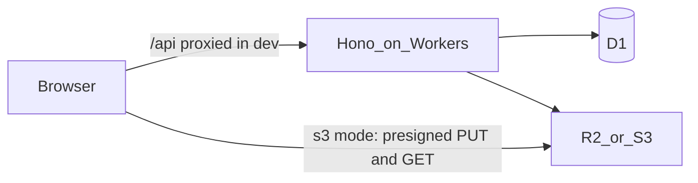
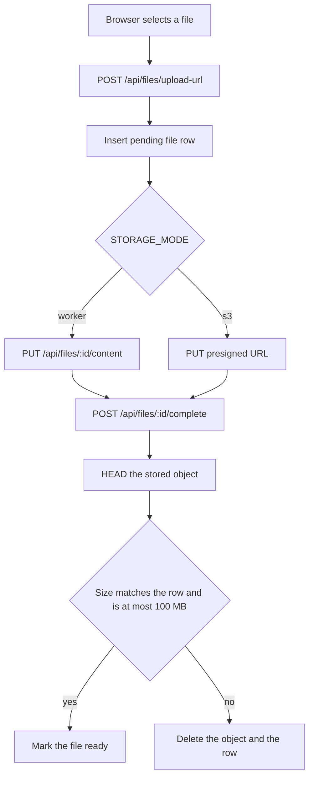
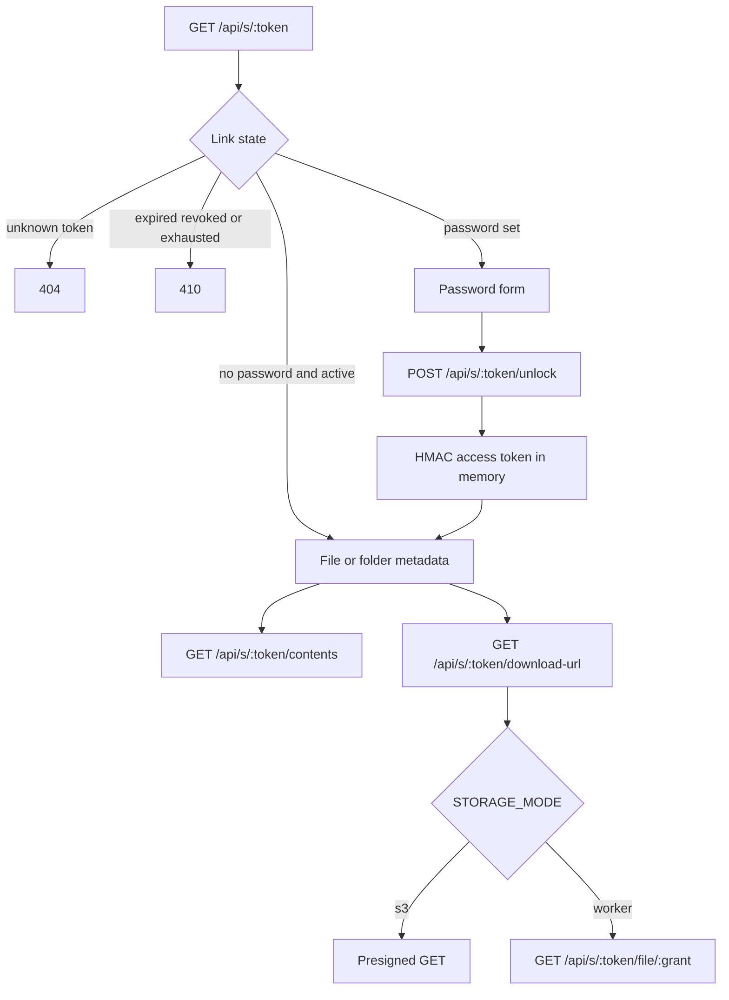
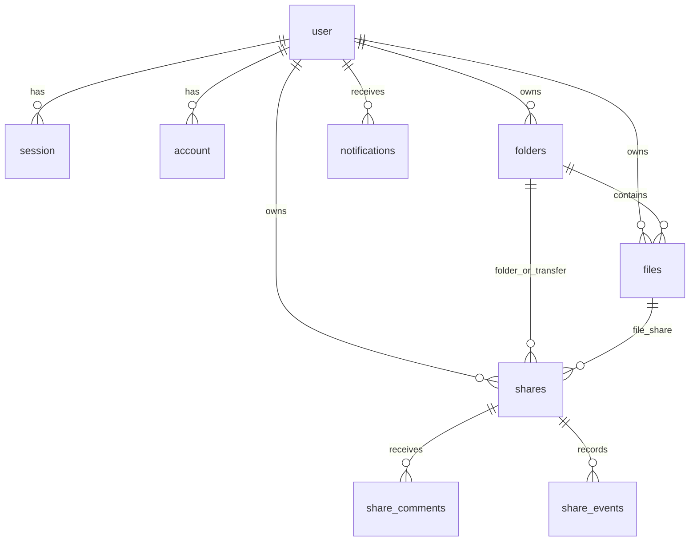

# Architecture

Transfile is a pnpm workspace. `apps/web` is the React app. `apps/api` is a Cloudflare Worker. `packages/shared` holds Zod schemas and the numeric limits both sides import.

## System

`STORAGE_MODE=worker` (the local default) keeps file bytes in the Worker's R2 binding. The browser then talks only to the API. `STORAGE_MODE=s3` (alias `presigned`) signs URLs with `aws4fetch` against an S3-compatible bucket. The browser uploads and downloads those URLs directly. See `docs/storage-setup.md`.

Auth is Better Auth at `/api/auth/*`, with email and password plus the anonymous plugin for guests. App tables reference `user.id`.

## Upload

The browser asks for an upload URL, sends the bytes, then asks the API to compare the stored object with the size it recorded.

In s3 mode the PUT signature can include `Content-Length` for the declared size. Presigned uploads expire after 10 minutes and downloads after 5 minutes (`apps/api/src/storage/s3.ts`). Completion always re-reads the object size from storage. A mismatch is a 400 and the object is deleted.

A transfer is a folder with `kind = transfer`. The send page creates one, uploads into it, then creates a share for that folder.

## Public share and download

Password links do not set a cookie. The browser keeps the access token in React state and sends `X-Share-Access`. Access grants last 30 minutes. Download grants last 5 minutes and do not increment the counter again when the bytes are fetched. The counter moves once, in `download-url`, with a conditional update so two parallel downloads cannot both pass a limit of one.

Preview URLs are a separate grant and do not count as downloads. Previews allow png, jpeg, webp, gif, and avif, up to 10 MB. SVG is not included.

## Data model

Better Auth owns `user`, `session`, `account`, and `verification`. The app tables are in `apps/api/src/db/schema.ts`. A share points at a file or a folder, not both; that rule is enforced in Zod, not by a SQL check.

`folders.kind` is `folder` or `transfer`. Transfer folders are omitted from folder listings. `files.status` is `pending` or `ready`. `share_events.visitor_hash` is stored for open dedupe and is not returned by the activity route. `share_comments.visitor_hash` is stored for the comment rate limit and is not returned. Neither table has an IP column. `session.ip_address` does exist, because that column comes from Better Auth.
